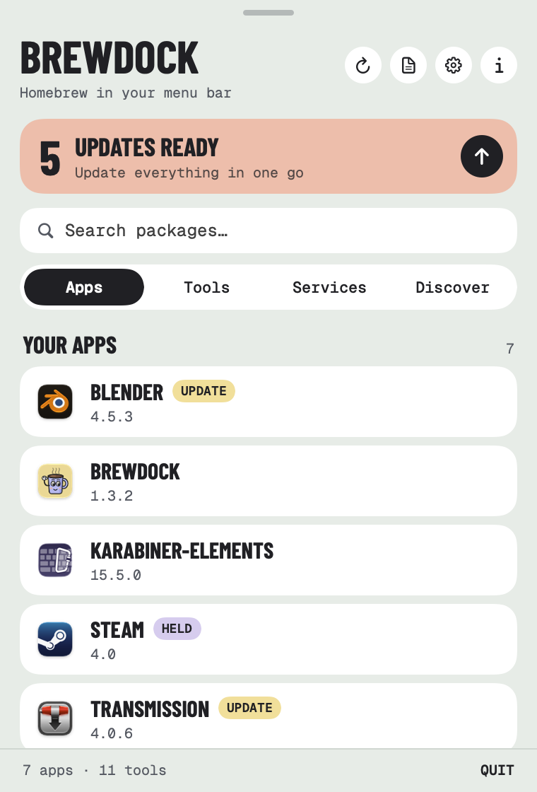
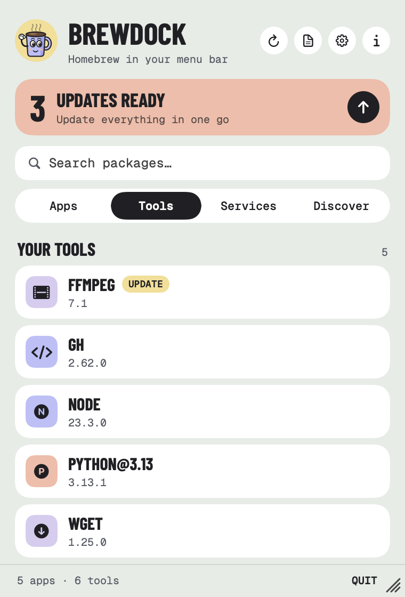
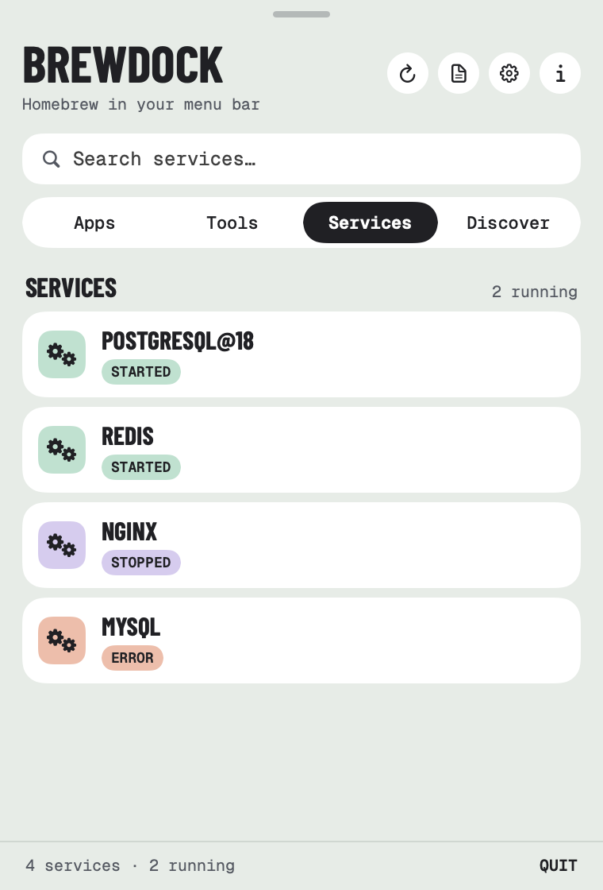
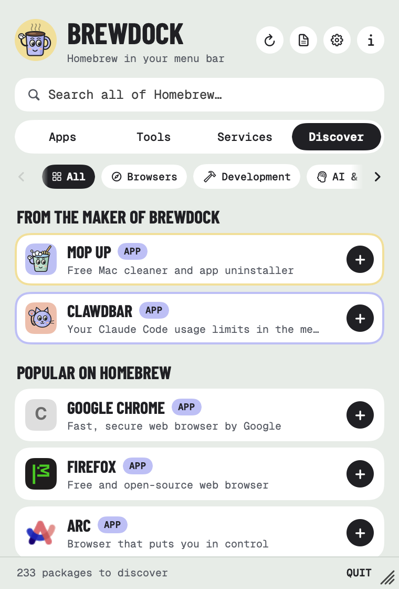
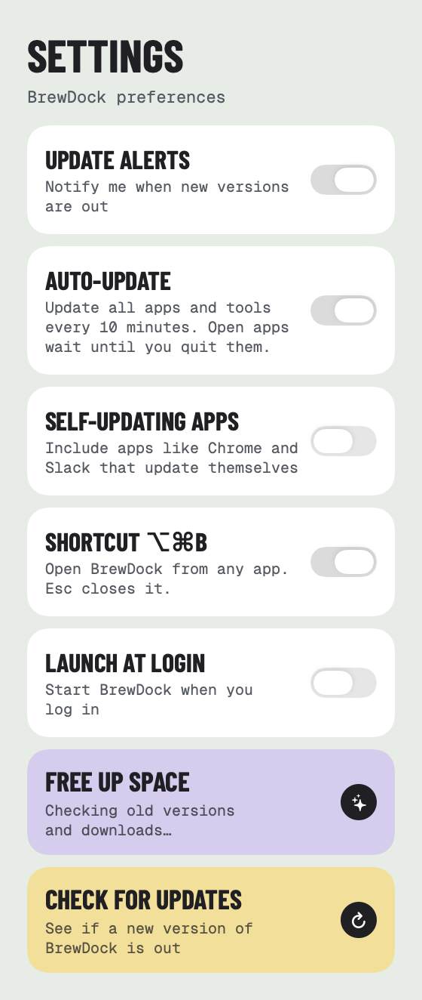
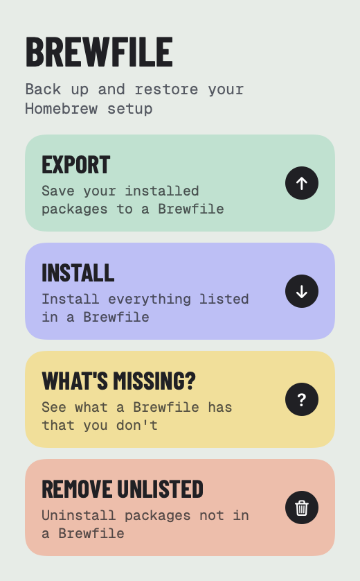
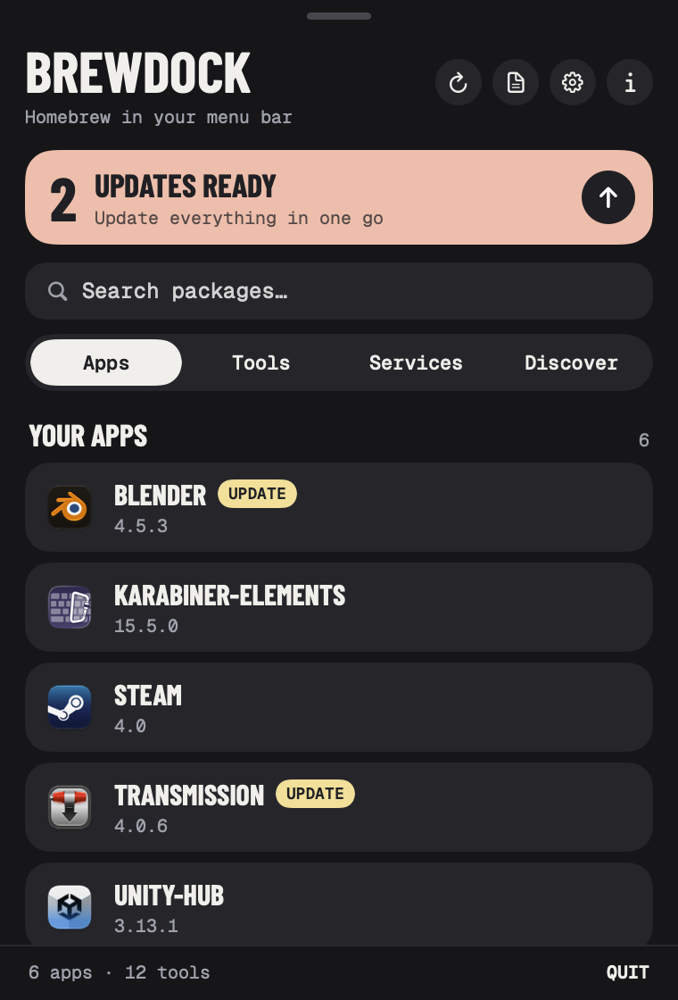

<p align="center">
  
</p>

<h1 align="center">BrewDock</h1>

<p align="center">
  <strong>Homebrew in your menu bar.</strong><br>
  A free, open-source Homebrew GUI for macOS. Browse, install, update and remove your Mac apps and tools without opening the Terminal.
</p>

<p align="center">
  <a href="https://github.com/RossNicholson/brewdock/releases/latest"></a>
  
  
  
  <a href="LICENSE"></a>
</p>

<p align="center">
  <picture>
    <source media="(prefers-color-scheme: dark)" srcset="docs/screenshot-dark.png">
    
  </picture>
</p>

<p align="center">
  <a href="#install">Install</a> ·
  <a href="#features">Features</a> ·
  <a href="#keyboard">Keyboard</a> ·
  <a href="#privacy">Privacy</a> ·
  <a href="#faq">FAQ</a> ·
  <a href="#build-from-source">Build</a> ·
  <a href="https://rossnicholson.dev/brewdock">Website</a>
</p>

---

## Install

```bash
brew tap RossNicholson/tap
brew trust --cask rossnicholson/tap/brewdock
brew install --cask brewdock
```

Homebrew 7 asks you to trust casks from other taps before installing them. On older versions of Homebrew, skip the `brew trust` line.

Then click the mug in your menu bar, or press **⌥⌘B** from any app.

**Requirements:** macOS 13 Ventura or later · [Homebrew](https://brew.sh) · Apple Silicon or Intel

### Updating

BrewDock checks for new versions of itself. Open **Settings → Check for updates → Update BrewDock**, and it quits, updates and reopens on its own. You can also run `brew upgrade --cask brewdock` in Terminal.

> **On BrewDock 1.2 or earlier with Homebrew 7?** If *Update BrewDock* fails, update once from Terminal. 1.3 and later handle this themselves:
> ```bash
> brew upgrade --cask rossnicholson/tap/brewdock
> ```

---

## Features

### Your apps and tools
- **Apps:** every Homebrew cask, with its real icon. Click to open; hover or right-click to update, show in Finder or uninstall.
- **Tools:** the formulae you installed come first. Dependencies Homebrew added for you are folded away below. Click a tool to open it in Terminal or iTerm2.
- **Services:** start, stop and restart Homebrew services like PostgreSQL and Redis.

### Updates
- **Background checks:** BrewDock refreshes Homebrew's package list every few hours. An orange dot on the menu bar icon means updates are waiting.
- **Update alerts:** optional notifications when new versions come out. Each update is announced once.
- **Update all,** or one at a time, with live progress ("Downloading…", "Unpacking…") instead of a bare spinner.
- **Auto-update:** off by default. Turn it on in Settings and BrewDock updates all your apps and tools every 10 minutes. Apps that are open wait until you quit them, and held packages are skipped.
- **Don't update:** right-click to hold a package at its current version. Tools use `brew pin`, so Terminal's `brew upgrade` respects it too.
- **Self-updating apps:** optionally include apps like Chrome and Slack, which Homebrew normally leaves out of updates.

### Discover
- **230+ hand-picked apps and tools** in 10 categories: browsers, development, AI, databases, DevOps, design, productivity, communication, security and utilities.
- **Search all of Homebrew:** type two or more letters and BrewDock also searches Homebrew's full catalogue.
- **One-click install,** with live progress.

### Housekeeping
- **Brewfile:** back up your setup, restore it on a new Mac, see what's missing, or remove anything not in the file.
- **Free up space:** see how much room old versions and cached downloads take, and clear them in one click.
- **Homebrew 7 trusted taps:** if Homebrew refuses a package from a tap you haven't trusted, BrewDock tells you which one, and asks before trusting it.

### Native and light
100% SwiftUI, with no Electron. It has light and dark mode, VoiceOver support, and a small mug who waves hello.

<table>
  <tr>
    <td align="center"><br><sub><b>Tools</b></sub></td>
    <td align="center"><br><sub><b>Services</b></sub></td>
    <td align="center"><br><sub><b>Discover</b></sub></td>
  </tr>
  <tr>
    <td align="center"><br><sub><b>Settings</b></sub></td>
    <td align="center"><br><sub><b>Brewfile</b></sub></td>
    <td align="center"><br><sub><b>Dark mode</b></sub></td>
  </tr>
</table>

---

## Keyboard

| Keys | What it does |
|---|---|
| **⌥⌘B** | Open BrewDock from any app, with the cursor in search (turn off in Settings) |
| **Esc** | Close the panel |
| **Right-click** a row | Open, Update, Show in Finder, Don't update, Uninstall… |

---

## Privacy

BrewDock collects nothing: no analytics, no accounts, no tracking. It runs the `brew` command on your Mac, and Homebrew does the downloading. The only other network requests are for app icons in Discover, which load from [icon.horse](https://icon.horse).

---

## FAQ

**Is BrewDock a Cakebrew alternative?**
Yes. Like Cakebrew, it's a free Homebrew GUI for the Mac. BrewDock lives in the menu bar rather than a window, and it also manages casks, Homebrew services, Brewfiles and Homebrew 7's trusted taps.

**Homebrew says it's "refusing to load" a cask from an untrusted tap.**
Homebrew 7 needs you to trust casks from taps other than its own. BrewDock shows a *Trust needed* banner naming the cask and its tap. Click **Trust** to allow it, and BrewDock retries whatever was refused.

**Chrome, Slack or Zoom never show an update.**
Those apps update themselves, so Homebrew skips them by default. Turn on **Settings → Self-updating apps** to include them.

**Can BrewDock keep everything updated automatically?**
Yes. Turn on **Settings → Auto-update** (it's off by default) and BrewDock runs `brew update` and upgrades all your apps and tools every 10 minutes. Apps that are open are updated once you quit them, and anything set to **Don't update** is left alone.

**An update or install failed.**
The message at the bottom of the panel includes Homebrew's reason. If BrewDock's own update fails, its log is at `~/Library/Application Support/BrewDock/brewdock-self-upgrade.log`.

**How do I uninstall BrewDock?**
Right-click it in the Apps tab, or run `brew uninstall --cask brewdock`. Add `--zap` to remove its settings too.

---

## Build from source

```bash
brew install xcodegen
git clone https://github.com/RossNicholson/brewdock.git
cd brewdock
xcodegen generate
open BrewDock.xcodeproj   # then press ⌘R
```

The `.xcodeproj` is generated from `project.yml`, so re-run `xcodegen generate` after editing that file or adding files.

| Command | What it does |
|---|---|
| `make test` | Run the unit tests |
| `make check-catalog` | Check the Discover catalog against Homebrew for renamed or retired packages (also runs weekly in CI) |
| `make release VERSION=x.y.z` | Ship a release; see [RELEASING.md](RELEASING.md) |

Bug reports, feature ideas and pull requests are welcome. [Open an issue](https://github.com/RossNicholson/brewdock/issues) to start.

---

## Support

BrewDock is made by [Ross Nicholson](https://rossnicholson.dev). For help, see the [support page](https://rossnicholson.dev/support) or email support@rossnicholson.dev.

If BrewDock saves you time, you can [buy me a coffee](https://buymeacoffee.com/rossnicholson) ☕

[](https://buymeacoffee.com/rossnicholson)

---

## License

GPL-3.0. See [LICENSE](LICENSE).

The bundled fonts, Barlow Condensed and Geist Mono, are under the SIL Open Font License (see `BrewDock/Fonts`). Homebrew is a separate project and isn't affiliated with BrewDock.
